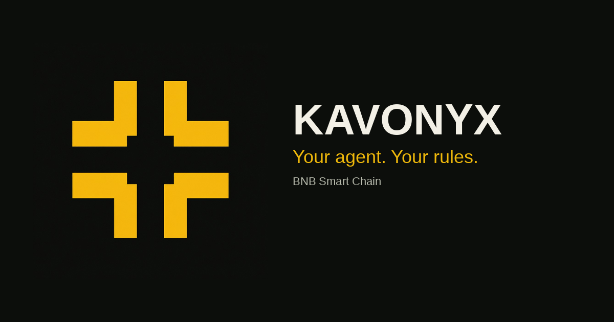
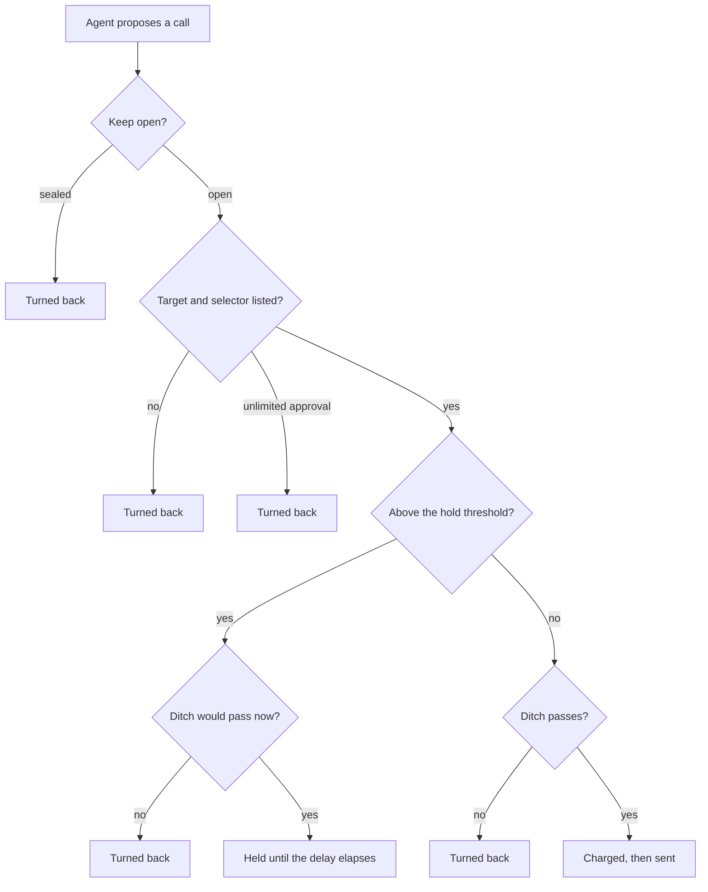
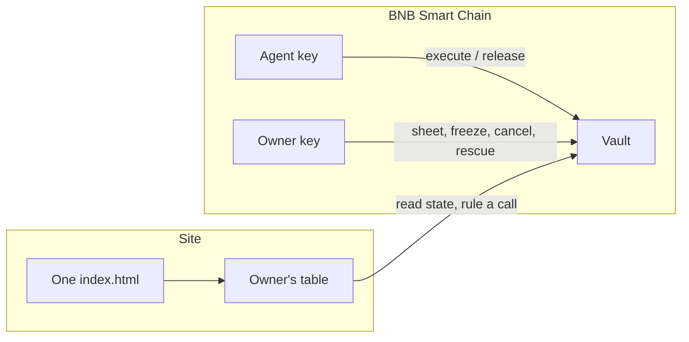

# Kavonyx

**Your agent. Your rules.**

Owner-controlled transaction limits for autonomous agents on BNB Smart Chain. The owner draws one sheet. The agent works inside it. Every call crosses four ramparts, or it does not land.



Kavonyx is a vault framework. Funds sit in a vault the owner controls. The agent may propose calls. The contract rules on each call before anything is sent. Native gas on BNB Smart Chain (chain id 56) is BNB. On BNB Smart Chain testnet (chain id 97) the native gas asset is tBNB.


The mark is four guards around an open centre. It is not a letter.

> **Status.** Not audited. The vault is not deployed on BNB Smart Chain from this repository. KVNX is a proposed symbol. It is not a deployed token: no supply, liquidity, or published token contract is claimed here. Do not send real funds to anything that presents itself as a Kavonyx vault or as KVNX.
>
> An independent project. Not affiliated with Binance or BNB Chain.

## What the vault decides

| Rampart | Question | If the answer is no |
|---|---|---|
| Keep | Is the fort still open? | The call is turned back. |
| Curtain | Is this contract and this function on the sheet? | The call is turned back. Unlimited approvals are turned back even when the target is listed. |
| Ditch | Does the value fit under the per-transaction, per-hour, and per-day ceilings? | The call is turned back. |
| Gate | Is the value above the hold threshold? | The call is stored until the delay passes. It is not sent yet. |

A call that passes all four is sent, and the ditch ceilings are charged at the moment it is sent.



Release of a held call is a second ruling. The keep, the curtain, and the ditch are checked again at release time, against the sheet and the buckets as they stand then. The owner may cancel a held call at any time before release. Held calls do not expire on their own.

## Architecture



| Path | Role |
|---|---|
| `contracts/` | Vault, Foundry tests, deploy script. Solidity 0.8.24, Cancun, optimizer 10 000 runs. |
| `backend/` | Chain client, deploy helper, and the read-only Aeon pack. |
| `frontend/` | One client application. `public/` holds assets. `dist/` is the built site. |
| `scripts/` | Build the site, regenerate the ABI, serve the preview. |
| `key.txt` | Address and contact lines the site reads. The copy in this tree is a placeholder. |

The site is one document. A persistent shell (navigation, footer) stays in place. Choosing a sheet replaces only the main region. The six routes are `/`, `/works/`, `/drawing/`, `/construction/`, `/name/`, and `/table/`.

## Order of a live call

`execute` is agent-only.

1. The keep refuses the call when the vault is frozen.
2. The curtain refuses a self-call, an unlisted pair of target and 4-byte selector, an unlimited ERC-20 approval, `setApprovalForAll(true)`, or an approval whose spender is not itself a listed contract.
3. If the native value, or a decoded token amount, is strictly above that asset's hold threshold, the ditch is checked immediately and the call is stored. Nothing is charged and nothing is sent.
4. Otherwise the ditch is checked, the buckets are charged, and the call is sent. A revert from the target rolls the charge back with the transaction.

Only `transfer`, `transferFrom`, `approve`, and `increaseAllowance` amounts are decoded as token value. Any other function you place on the allowlist is not measured by the ditch. List only functions whose value movement you accept uncounted, or whose value is the native `msg.value`.

The owner has a separate entry that does not cross the ramparts. It exists so the owner can rescue funds. The agent cannot call it.

## The ditch

Limits are stored per asset. The native asset is `address(0)`. Each asset has a flag `set`, three ceilings, and a hold threshold:

\[
(c_{\mathrm{tx}},\; c_{h},\; c_{d},\; \theta)
\]

Time is the chain timestamp \(t\), in seconds. The hour and UTC-day buckets are

\[
h(t)=\left\lfloor\frac{t}{3600}\right\rfloor,
\qquad
d(t)=\left\lfloor\frac{t}{86400}\right\rfloor.
\]

The vault remembers, for each asset, the epoch it last charged and how much it charged in that epoch. The amount already counted at time \(t\) is

\[
S_h(t)=
\begin{cases}
s_h & \text{if the stored hour epoch equals } h(t),\\
0 & \text{otherwise,}
\end{cases}
\qquad
S_d(t)=
\begin{cases}
s_d & \text{if the stored day epoch equals } d(t),\\
0 & \text{otherwise.}
\end{cases}
\]

A positive amount \(x\) is inside the ditch only when the limits are set and all three inequalities hold:

\[
x \le c_{\mathrm{tx}},
\qquad
S_h(t)+x \le c_h,
\qquad
S_d(t)+x \le c_d.
\]

If the limits were never set, the asset cannot move through the agent path at all.

The buckets are fixed windows, not rolling windows. When the hour index changes, \(S_h\) becomes 0 even if the previous hour was full a second earlier. The same is true of the day index at midnight UTC.

**Bound at a boundary.** Take an interval of length \(3600+\varepsilon\) that contains exactly one hour boundary and no midnight. Each of the two hour buckets may be filled up to \(c_h\), so the sum of amounts that pass the hour test on that interval can be as large as \(2c_h\). The day ceiling still applies, so the sum is also at most \(c_d\) while \(d(t)\) does not change. Across midnight both indexes reset, and the same reasoning gives an upper bound of \(2c_d\) on a short interval that contains midnight.

That bound is a property of the bucket definition. It is not a second allowance the owner configured. Size \(c_h\) and \(c_d\) with it in mind.

## The gate

\[
\mathrm{hold}(x)=\mathbf{1}\{\theta \ne 0 \land x > \theta\}.
\]

If \(\theta = 0\), nothing is held for that asset. If \(\theta > 0\), an amount strictly greater than \(\theta\) is queued instead of sent. The release time is

\[
\eta = t + \Delta,
\]

where \(\Delta\) is the gate delay in seconds. A release before \(\eta\) is refused. After \(\eta\), either the agent or the owner may release, and the keep, curtain, and ditch are applied again. Cancelling deletes the record. There is no automatic expiry: a held call remains until it is released or the owner cancels it.

Native value and a decoded token amount are tested separately. If either one is over its own threshold, the whole call is held, provided the ditch would accept both amounts at queue time.

## A model for sizing a sheet

The formulas above are the rule. This section is a model for choosing numbers. It assumes a shape for the agent's traffic. It is not a forecast, and it is not a statement about safety.

**Constant size.** Suppose a fresh hour, a day cap that is not binding, and \(n\) transactions of identical size \(a\) with \(0 < a \le c_{\mathrm{tx}}\). The number that pass the hour ceiling is

\[
K=\min\left(n,\left\lfloor\frac{c_h}{a}\right\rfloor\right).
\]

The number turned back by that ceiling is \(n-K\). The fraction turned back, when \(n>0\), is

\[
1-\frac{K}{n}.
\]

**Random size, one empty bucket.** Let \(X\) be the size of a single transaction drawn when \(S_h=S_d=0\), and let \(F\) be its cumulative distribution function. The transaction fails the per-transaction ceiling with probability

\[
\mathbb{P}(X>c_{\mathrm{tx}})=1-F(c_{\mathrm{tx}}).
\]

It fails the hour ceiling with probability \(1-F(c_h)\), and the day ceiling with probability \(1-F(c_d)\). Because the three tests are nested when the buckets are empty and the ceilings are ordered \(c_{\mathrm{tx}}\le c_h\le c_d\), the probability of passing the ditch is \(F(c_{\mathrm{tx}})\).

**Random size, many draws in one hour.** Let \(X_1,X_2,\ldots\) be i.i.d. positive sizes with mean \(\mu\in(0,\infty)\), each already at most \(c_{\mathrm{tx}}\). Define the stopping index

\[
K=\max\left\{k\ge 0:\sum_{i=1}^{k} X_i \le c_h\right\}.
\]

\(K\) transactions pass the hour ceiling. The next one is turned back if it would cross \(c_h\). The sum that actually lands is at most \(c_h\), and the unused remainder in the bucket is strictly positive whenever that next draw would have crossed. When \(c_h\) is large relative to \(\mu\),

\[
\mathbb{E}[K]\approx\frac{c_h}{\mu}.
\]

The error in that approximation is on the order of one transaction, from the unused remainder. Use it to pick a ceiling, then read the exact inequalities in the previous section as the rule the contract enforces.

**Unlimited approval.** An `approve` or `increaseAllowance` whose amount equals \(2^{256}-1\), and a `setApprovalForAll` that turns the approval on, are refused by the curtain with probability 1 under the rule. The allowlist does not override that refusal.

## A worked sheet

The figures below are an illustration of the arithmetic, in the same spirit as the example sheet on the site. They are not defaults in the contract. Every deployed vault starts with no allowlist and no ceilings until its owner writes them.

Take

\[
c_{\mathrm{tx}}=0.10,\quad c_h=0.40,\quad c_d=1.00,\quad \theta=0.50,\quad \Delta=6\text{ h},
\]

with amounts in BNB, and with both buckets empty.

| Proposed call | Ditch | Gate | Result |
|---|---|---|---|
| Buy 0.04, listed selector | \(0.04\le 0.10\), hour and day clear | \(0.04\le 0.50\) | Sent. Hour bucket becomes 0.04. |
| Buy 0.12 | \(0.12>0.10\) | not reached | Turned back. Buckets unchanged. |
| Four buys of 0.10 after a fresh hour | \(4\times 0.10=0.40\le 0.40\) | at the threshold, not over it | All four sent. The fifth 0.10 is turned back: \(0.40+0.10>0.40\). |
| Send 0.80 | \(0.80>0.10\) | would have been over 0.50 | Turned back by the per-transaction ceiling before a hold is queued. |
| Send 0.08, then later 0.60, with \(c_{\mathrm{tx}}\) raised to 1.00 by the owner | 0.60 fits the ceilings | \(0.60>0.50\) | Held for 6 hours. Caps are not charged until release. |

After the four 0.10 buys, the day bucket holds 0.40. A new hour resets only \(S_h\). The day test still sees 0.40, so at most 0.60 more can pass before midnight, and at most 0.40 of that in the new hour.

If those four 0.10 buys land just before the hour boundary and four more land just after, the hour tests accept \(0.80\) across a few seconds. The day test still stops the total at \(1.00\). That is the boundary bound, in numbers.

## Chain data the readers use

The owner's table and the Aeon pack read logs from `https://bsc.publicnode.com`. That endpoint rejects `eth_getLogs` ranges wider than 50 000 blocks. Readers ask for at most 45 000 blocks in a chunk and keep about 750 000 blocks of history. A gate delay longer than the free history window can hide an older held call from those readers. The call is still in the contract. The free endpoint is what cannot see it.

A vault is trusted by the Aeon pack only when the bytecode hash equals the pin recorded in `backend/aeon/skills/vauban-vault/vault.mjs`. The pin in this tree is

```text
b2b1e5b9ccc1ccf6dcdc045f25b123f1ea2a4c4e56eafa6e65f34cdadabee8df
```

Any change to the contract source, including a comment, changes metadata and the hash. Regenerate the ABI and the bytecode together, then update the pin. CI checks that the generated files match a fresh build.

## Build and test

```sh
git submodule update --init
cd contracts && forge test

cd backend && npm ci && npm run typecheck && npm test
node --test backend/aeon/test/vault.test.mjs

python3 scripts/build.py
python3 scripts/serve.py
```

The preview listens on `127.0.0.1:8090`. `forge test` needs Foundry. The backend tests that talk to a chain need Anvil. The Aeon pack tests do not.

After a contract change:

```sh
python3 scripts/abi.py
```

Then update `CODEHASH` so `backend/src/abi.ts`, `backend/src/bytecode.ts`, and the pin agree. `git diff --exit-code` on those generated files is the check CI runs.

## Deploy

Nothing in this repository publishes a vault. Deploy an empty vault of your own, draw the sheet from the owner key, and paste that address into the owner's table.

```sh
# Foundry. Needs VAUBAN_OWNER, VAUBAN_AGENT, and a funded deployer.
cd contracts && forge script script/Deploy.s.sol --rpc-url bsc --broadcast

# Testnet, chain id 97, gas is tBNB.
forge script script/Deploy.s.sol --rpc-url bsc_testnet --broadcast

# TypeScript. Dry run unless you pass --yes.
# Testnet also needs VAUBAN_ALLOW_TESTNET=1 and RPC_URL.
cd backend && DEPLOYER_KEY=0x… node --experimental-strip-types scripts/deploy.ts --owner 0x… --agent 0x… --delay 21600
```

`backend/scripts/set-ca.ts` refuses to publish a token address into `token.json`. The address shown on the site comes from `key.txt`, not from that file.

## Known limits

- Hour and day ceilings are fixed buckets. Across one boundary the sum that passes can reach twice the ceiling, as derived above. The other ceiling still applies.
- Only four ERC-20 selectors contribute a token amount. Any other value-moving function on the allowlist is not capped.
- Held calls do not expire.
- The free log endpoint is limited to 50 000 blocks per query and about 750 000 blocks of history.
- The contract is not audited. A pass from `rule` is a local application of the sheet, not an opinion about the target contract.

## License

MIT. See [LICENSE](LICENSE).
